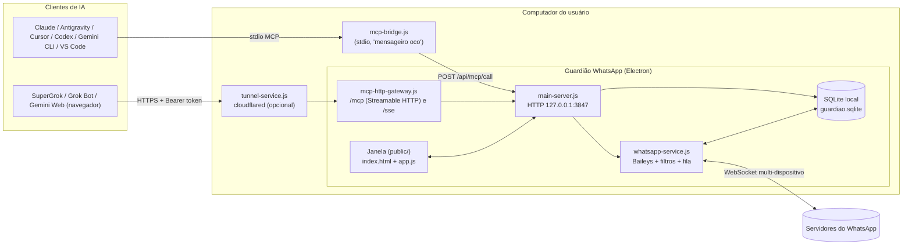
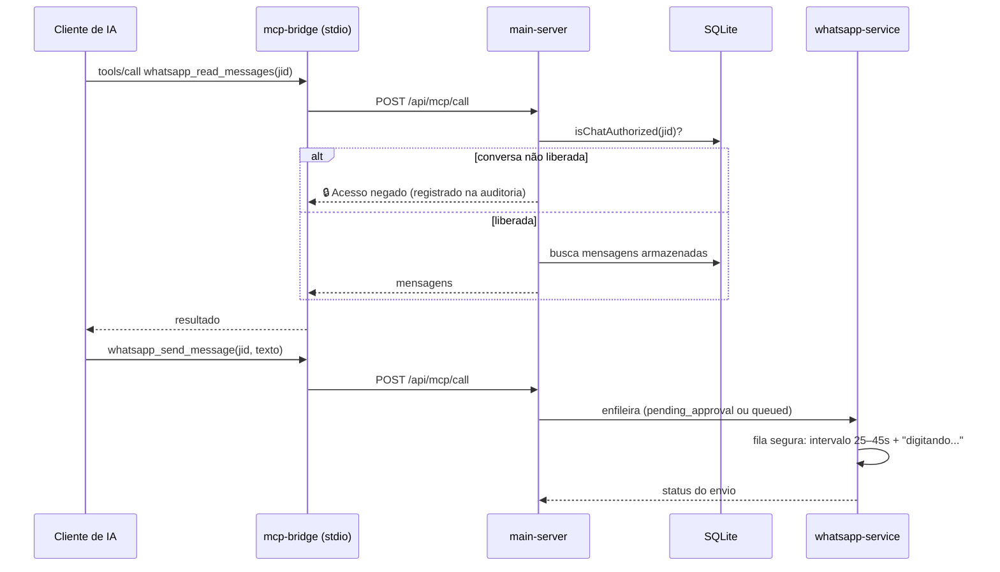

# 🛡️ Guardião WhatsApp (WhatsApp Guard MCP)

Aplicativo desktop para Windows que conecta **o seu WhatsApp** a assistentes de IA (Claude, Antigravity, Gemini, Grok, Codex, Cursor, VS Code/Copilot, Windsurf…) via **MCP (Model Context Protocol)**. Você decide o que a IA pode ver e o que ela pode enviar.

> A IA só enxerga as conversas que você liberou (grupos marcados, contatos com uma tag no nome ou com uma etiqueta do WhatsApp Business). Conversas privadas são descartadas na memória e **nunca chegam ao disco**.

> [!WARNING]
> Projeto **não oficial**, sem nenhuma ligação com o WhatsApp/Meta. A conexão usa o protocolo do WhatsApp Web (multi-dispositivo) através da biblioteca open source [Baileys](https://github.com/WhiskeySockets/Baileys). O uso automatizado pode violar os Termos de Serviço do WhatsApp e levar a bloqueio do número. Use por sua conta e risco, com moderação e só em conversas suas.

---

## Sumário

- [Principais recursos](#principais-recursos)
- [Como funciona (arquitetura)](#como-funciona-arquitetura)
- [Modelo de privacidade](#modelo-de-privacidade)
- [Proteção anti-banimento](#proteção-anti-banimento)
- [Ferramentas MCP expostas](#ferramentas-mcp-expostas)
- [Clientes de IA suportados](#clientes-de-ia-suportados)
- [Instalação e desenvolvimento](#instalação-e-desenvolvimento)
- [Onde ficam os dados](#onde-ficam-os-dados)
- [Estrutura do código](#estrutura-do-código)
- [Detalhes técnicos importantes](#detalhes-técnicos-importantes)
- [Bibliotecas e projetos de terceiros](#bibliotecas-e-projetos-de-terceiros)

---

## Principais recursos

- **Conexão por QR Code**, igual ao WhatsApp Web. A sessão volta sozinha quando o app é reaberto.
- **Filtro de conversas liberadas** de três formas:
  1. grupos marcados manualmente;
  2. contatos com uma **tag no nome** da agenda (ex.: `[EMP]`, `#work`);
  3. contatos com uma **etiqueta/lista do WhatsApp** com o mesmo nome da tag.
- **Memória transparente:** uma aba mostra exatamente o que a IA consegue ler, e dá para apagar mensagens específicas ou as últimas horas.
- **Envios com aprovação:** mensagens da IA para contatos individuais/grupos podem exigir 1 clique de confirmação.
- **Fila segura de envio:** intervalo aleatório de 25–45 s entre mensagens, simulação de "digitando…" e limite por hora.
- **Salvar contatos na agenda** (WhatsApp + agenda do celular) e aplicar etiquetas, um por vez ou em lote, sempre com aprovação.
- **Instalação em 1 clique nos clientes de IA:** o app detecta os programas instalados e grava a configuração MCP de cada um.
- **IAs no navegador** (SuperGrok, Grok Bot, Gemini Web, ChatGPT…) por meio de um endpoint MCP HTTP com token, publicado opcionalmente por um túnel Cloudflare.
- **Só funciona com a janela aberta:** ao fechar o app, o servidor local desliga e a IA recebe "programa fechado".
- **Log de auditoria** de tudo que a IA consultou, enviou ou teve bloqueado.

---

## Como funciona (arquitetura)



### Processos

| Processo | Arquivo | Papel |
|---|---|---|
| **UI Electron** | `src/electron-main.js` | Abre a janela e inicia o motor num processo filho isolado (`ELECTRON_RUN_AS_NODE`). Ao fechar a janela, encerra o motor. |
| **Motor / servidor local** | `src/main-server.js` | Servidor HTTP em `127.0.0.1:3847`: entrega a interface, a API REST da janela, o endpoint interno `/api/mcp/call` e o gateway MCP HTTP. |
| **Ponte MCP (stdio)** | `src/mcp-bridge.js` | Único executável registrado nos clientes de IA. **Não acessa** WhatsApp nem banco: só repassa as chamadas ao app aberto. Se o app estiver fechado, devolve um erro claro. |
| **Gateway MCP HTTP** | `src/mcp-http-gateway.js` | Expõe as mesmas ferramentas via Streamable HTTP (`/mcp`) e SSE legado (`/sse`), protegidas por token Bearer (comparação em tempo constante). |
| **Túnel (opcional)** | `src/tunnel-service.js` | Baixa/usa o `cloudflared` para publicar o gateway numa URL HTTPS temporária (ou num domínio próprio configurado). |

### Fluxo de uma chamada da IA



---

## Modelo de privacidade

1. **Filtro na entrada:** toda mensagem recebida passa por `handleIncomingWhatsAppMessage`. Se a conversa não estiver liberada, ela é descartada **antes** de ir para o banco (só um contador de descartes é incrementado).
2. **Filtro na leitura:** toda ferramenta MCP confere de novo a autorização (`isChatAuthorized`) antes de devolver dados.
3. **Sem escalada de privilégio:** a IA não consegue liberar conversas novas. Salvar contato/etiqueta só é permitido quando isso não transforma uma conversa privada em liberada, e sempre com aprovação do usuário.
4. **Chave geral:** o botão "Acesso da IA" pausa todas as ferramentas na hora.
5. **Tudo local:** banco, sessão e logs ficam só no computador do usuário. O túnel é opcional, desligado por padrão, e exige token.

---

## Proteção anti-banimento

- Fila única de envio com **intervalo aleatório de 25 a 45 s** entre mensagens (relógio monotônico).
- Simulação de presença "digitando…" proporcional ao tamanho do texto.
- **Limite de mensagens por hora** configurável.
- Aprovação obrigatória (configurável) para contatos individuais, grupos e gravação na agenda.
- Bloqueio de envio para números fora da lista liberada.
- Sincronizações pesadas (grupos e agenda completa) com **cooldown de 15 min**, evitando `rate-overlimit` do WhatsApp.
- Reconexão automática com *backoff* exponencial **sem apagar a sessão** em quedas temporárias (só um logout real exige novo QR Code).

---

## Ferramentas MCP expostas

| Ferramenta | Descrição |
|---|---|
| `whatsapp_get_status` | Estado do app, conexão, número de conversas liberadas e política anti-ban. |
| `whatsapp_list_authorized_chats` | Lista só os grupos/contatos liberados. |
| `whatsapp_read_messages` | Lê mensagens de uma conversa liberada. |
| `whatsapp_search_messages` | Busca texto nas conversas liberadas. |
| `whatsapp_get_recent_activity` | Últimas mensagens de todas as conversas liberadas. |
| `whatsapp_fetch_older_messages` | Pede ao celular um histórico mais antigo de uma conversa liberada. |
| `whatsapp_send_message` | Envia (ou coloca na fila de aprovação) uma mensagem. |
| `whatsapp_list_labels` | Lista as etiquetas/listas do WhatsApp e as tags ativas. |
| `whatsapp_save_contact` | Prepara a gravação de um contato na agenda (com aprovação). |
| `whatsapp_save_contacts_batch` | Prepara até 30 contatos de uma vez (aprovação em lote). |

---

## Clientes de IA suportados

Instalação automática (o app grava o bloco `whatsapp-guard` no arquivo de configuração de cada cliente):

- **Antigravity** · **Claude Desktop / Claude Code** (instalador clássico e Microsoft Store) · **Google Gemini CLI / Code Assist** · **Codex (OpenAI)** · **Cursor** · **VS Code / GitHub Copilot** · **Grok CLI** · **Windsurf**

Pelo navegador (via gateway HTTP + túnel): **SuperGrok / Grok Bot**, **Gemini Web/Enterprise**, **ChatGPT** e outros conectores MCP remotos.

Configuração manual (stdio), se preferir:

```json
{
  "mcpServers": {
    "whatsapp-guard": {
      "command": "node",
      "args": ["C:/caminho/para/whatsapp-guard-mcp/src/mcp-bridge.js"]
    }
  }
}
```

---

## Instalação e desenvolvimento

Pré-requisitos: **Windows 10/11**, **Node.js 22.5+** (usa o módulo nativo `node:sqlite`) e npm.

```bash
git clone https://github.com/jonnysundae/whatsapp-guard-mcp.git
cd whatsapp-guard-mcp
npm install

npm start          # abre o app em modo desenvolvimento (Electron)
npm run build      # gera o instalador em dist/ (electron-builder, NSIS)
npm run mcp        # roda só a ponte MCP stdio (para testes)
```

Variáveis de ambiente opcionais:

| Variável | Padrão | Uso |
|---|---|---|
| `WHATSAPP_GUARD_PORT` | `3847` | Porta do servidor local. |
| `WHATSAPP_GUARD_URL` | `http://127.0.0.1:3847` | URL usada pela ponte MCP. |

Também existe um **modo demonstração**, com contatos fictícios, para testar a interface sem conectar um WhatsApp real.

---

## Onde ficam os dados

Tudo fica na máquina do usuário, fora da pasta do projeto (e ignorado pelo `.gitignore`):

| Sistema | Pasta |
|---|---|
| Windows | `%LOCALAPPDATA%\GuardiaoWhatsApp\` |
| macOS/Linux | `~/.guardiao-whatsapp/` |

Conteúdo: `wa_auth/` (sessão do WhatsApp; **equivale a estar logado: nunca compartilhe**), `guardiao.sqlite` (configurações, conversas liberadas, fila, auditoria) e `guardiao.log`.

---

## Estrutura do código

```
├── build/icon.png              # ícone do instalador
├── public/                     # interface da janela (HTML/CSS/JS puro, sem framework)
│   ├── index.html
│   ├── app.js
│   └── styles.css
└── src/
    ├── electron-main.js        # processo principal do Electron
    ├── main-server.js          # servidor HTTP local + roteamento das ferramentas MCP
    ├── whatsapp-service.js     # conexão Baileys, filtros, fila anti-ban, agenda/etiquetas (AppState)
    ├── db.js                   # SQLite (node:sqlite): esquema, regras de autorização, filas
    ├── mcp-bridge.js           # servidor MCP stdio ("mensageiro oco")
    ├── mcp-http-gateway.js     # servidor MCP Streamable HTTP / SSE com token
    ├── tunnel-service.js       # túnel Cloudflare opcional
    ├── ai-installer.js         # detecção e configuração automática dos clientes de IA
    └── logger.js               # log em arquivo com rotação simples
```

### Tabelas SQLite

| Tabela | Conteúdo |
|---|---|
| `settings` | Configurações (tags, limites, token do gateway…). |
| `directory_chats` | Diretório de conversas (nome, origem do nome, vínculo `@lid` ↔ telefone, permissão). |
| `messages` | Só mensagens de conversas liberadas. |
| `outbox_queue` | Fila de envios da IA (aprovação, digitando, enviado, falha). |
| `contact_save_queue` | Fila de contatos a gravar na agenda. |
| `whatsapp_labels` | Catálogo de etiquetas do WhatsApp. |
| `audit_logs` | Auditoria de ações da IA. |

---

## Detalhes técnicos importantes

- **Agenda e etiquetas via AppState (`w:sync:app:state`):** o app baixa e decifra diretamente os snapshots/patches das coleções do WhatsApp para ler contatos salvos (`contactAction`, `lidContactAction`), vínculos `@lid` ↔ telefone (`pnForLidChatAction`) e etiquetas (`labelEditAction`, `labelAssociationAction`). Isso contorna limitações do Baileys nesses tipos.
- **Gravação na agenda:** usa `encodeSyncdPatch` do Baileys com escolha da chave de assinatura correta em contas com várias chaves rotacionadas, e repete automaticamente em caso de conflito (409).
- **LTHash tolerante:** o histórico da agenda costuma conter operações `REMOVE` para índices que nunca existiram. O Baileys aborta com `tried remove, but no previous op`; aqui essas remoções órfãs são ignoradas (mesmo comportamento do [whatsmeow](https://github.com/tulir/whatsmeow)), e o hash resultante é conferido contra o MAC enviado pelo servidor.
- **Reconexão:** só `401/403/411` (sessão desvinculada no celular) apagam a sessão. Erros de stream transitórios (`500`, `428`, `503`, `408` já pareado) reconectam com *backoff*. `440` (conexão substituída) não entra em loop.

---

## Bibliotecas e projetos de terceiros

Este projeto foi construído sobre software open source pronto. Créditos e agradecimentos:

| Projeto | Uso | Licença |
|---|---|---|
| [Baileys (@whiskeysockets/baileys)](https://github.com/WhiskeySockets/Baileys) | Conexão com o WhatsApp Web multi-dispositivo (protocolo, criptografia Signal, AppState) | MIT |
| [Model Context Protocol TypeScript SDK](https://github.com/modelcontextprotocol/typescript-sdk) | Servidores MCP stdio, Streamable HTTP e SSE | MIT |
| [Electron](https://www.electronjs.org/) | App desktop | MIT |
| [electron-builder](https://www.electron.build/) | Geração do instalador Windows (NSIS) | MIT |
| [Zod](https://zod.dev/) | Validação dos parâmetros das ferramentas MCP | MIT |
| [node-qrcode](https://github.com/soldair/node-qrcode) | Geração do QR Code de pareamento | MIT |
| [Pino](https://getpino.io/) | Logger exigido pelo Baileys (silenciado) | MIT |
| [cloudflared](https://github.com/cloudflare/cloudflared) | Túnel HTTPS opcional (baixado sob demanda, não incluído no repositório) | Apache-2.0 |
| `node:sqlite` (Node.js) | Banco de dados local embutido | MIT (Node.js) |
| [whatsmeow](https://github.com/tulir/whatsmeow) | Referência de comportamento para o LTHash tolerante (nenhum código copiado) | MPL-2.0 |

O desenvolvimento contou com ajuda de assistentes de IA para programar.

---

## Aviso legal

"WhatsApp" é marca registrada da WhatsApp LLC/Meta. Este projeto não é afiliado, endossado nem patrocinado pela Meta. Ele é oferecido "como está", sem garantias. Respeite a privacidade das pessoas com quem você conversa e as leis aplicáveis (ex.: LGPD).
